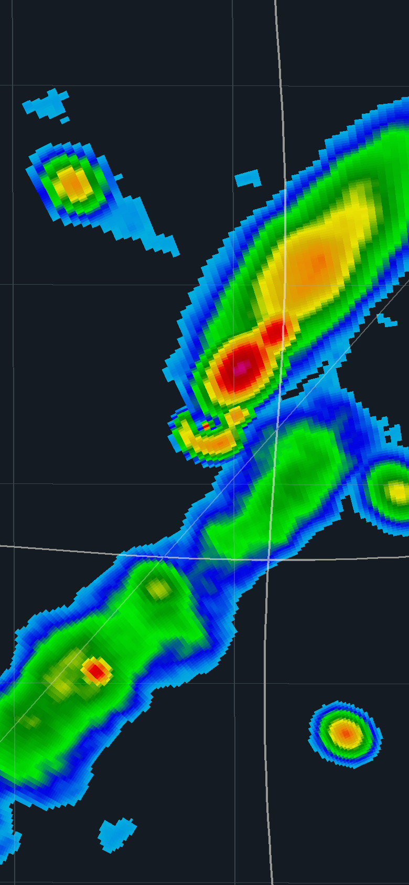
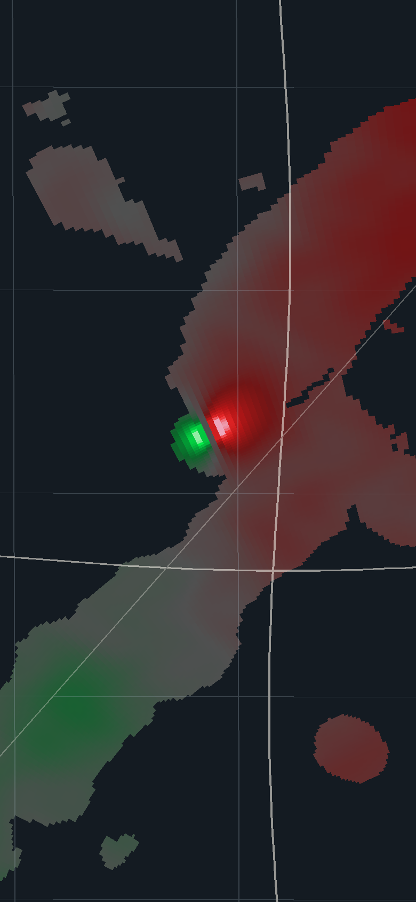

# Hookline Radar

**The professional weather radar you buy once.** Every product, every tilt, every warning and thirty years of archive, for one price on Android. No tiers, no subscriptions, no account, no ads.

<p>
  
  
</p>

> Named after the hook echo, the radar signature of a rotating storm. Mockup imagery is procedurally generated (`tools/mockup-radar/radar.py`), not real radar data.

## Why it exists
RadarScope is the benchmark for pro radar, but you pay for the app and then subscribe twice to unlock watches, outlooks, long loops, Level II and the archive — roughly **$110 in year one** for the full feature set. Nearly all of that data is free public NOAA/NWS data. Hookline reads it directly, so it can be sold once, at **$19.99**, with everything included.

Full teardown: [`docs/01-COMPETITIVE-ANALYSIS.md`](docs/01-COMPETITIVE-ANALYSIS.md)

## Docs
| | |
|---|---|
| [01 Competitive analysis](docs/01-COMPETITIVE-ANALYSIS.md) | RadarScope strengths, 12 weaknesses, pricing, risks |
| [02 Product spec](docs/02-PRODUCT-SPEC.md) | Personas, principles, full feature set, IA, Storm Mode, milestones |
| [03 Design system](docs/03-DESIGN-SYSTEM.md) | "The map is the only colour", tokens, type, signature components |
| [04 Architecture](docs/04-ARCHITECTURE.md) | Modules, data sources, rendering plan, reliability |

## Project layout
```
app/                 Compose UI (map screen), Storm Mode worker + foreground service
core/radar/          NEXRAD Level II decoder, palettes (.pal import), polar geometry, SRV, rasterizer
core/data/           NOAA S3 (real-time chunks + archive), NWS alerts API
core/designsystem/   Hookline theme tokens and components
tools/mockup-radar/  Generator for the synthetic supercell imagery used in mockups
```

## Build
Requirements: JDK 17, Android SDK 35.

```bash
./gradlew :core:radar:test :core:data:test   # fast JVM tests
./gradlew :app:assembleDebug                  # debug APK
```

CI (GitHub Actions) runs both on every push and uploads the debug APK as an artifact.

## Status
Alpha (milestone M1 in progress).

Working now:
- **Live radar**: streams NEXRAD Level II real-time chunks straight from NOAA's public bucket and shows each tilt the moment it finishes scanning. Handles split cuts, SAILS re-scans and the 1–999 volume-number wraparound.
- **Base map**: MapLibre vector map (OpenFreeMap / OpenStreetMap) drawn *above* the radar on a transparent layer, so roads and town names stay readable over echoes. Radar is projected in Web Mercator with great-circle placement, locked to the map camera. Sliders for roads, names and borders.
- **Offline maps**: save the visible area (zoom 3–10) for chasing without signal.
- **Loops**: 0.5° REF / VEL / SRV. Earlier frames are backfilled from the first chunks of previous volumes (~1–2 MB each); new scans append live. Play, pause, tap or drag to scrub.
- **Storm motion**: SRV uses the motion from the NWS warning nearest where you're looking; storm tracks drawn to +45 min.
- **GPU renderer**: OpenGL ES 3, one wedge per radial, R32F value texture sampled nearest-bin, palette LUT in the shader.
- **Products**: REF, VEL, storm-relative velocity, CC, ZDR, every available tilt.
- **Inspector**: long-press any point for the value, a plain-English meaning, beam height and distance.
- **Warnings**: tornado, severe and flash-flood outlines; banner when one covers your Home place.
- **Offline fallback**: a clearly labelled synthetic demo storm when the feed can't be reached.

Next: full site list with nearest-radar switching, mosaic (MRMS) when zoomed out, notification permission and Storm Mode settings, legacy Message 1 for pre-2008 archives.

Test builds: every push to `main` publishes split APKs on the Releases page (`arm64-v8a` for most phones).

## Data
Radar and warning data courtesy of NOAA / National Weather Service, accessed via the NOAA Open Data Dissemination program on AWS and api.weather.gov. Hookline is not affiliated with or endorsed by NOAA or the NWS, and it is not an official warning service.

---
© 2026 — all rights reserved (commercial app; no open-source licence granted).
